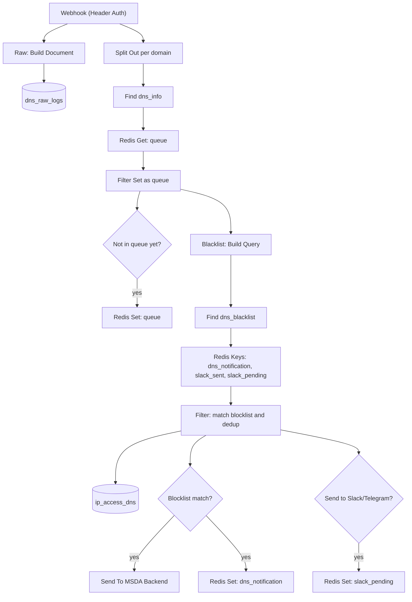
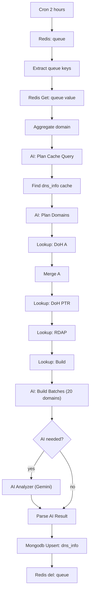
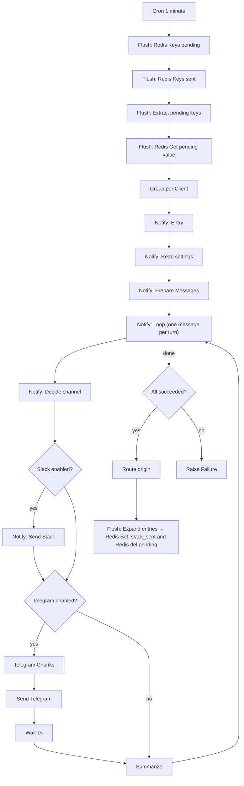

# MSDA — MikroTik Smart DNS Analytics

**MSDA** is the continuation of **SATA-AI (Smart AP Traffic Analyzer)**. MikroTik remains the main router; the name MSDA makes that explicit. MSDA builds a more complete DNS data pipeline: AI domain classification, Slack and Telegram notifications, anomaly detection, automatic blocklist sync, **optional DNS blocking with AdGuard Home**, daily and weekly reports, and a web dashboard with login and user roles.

Base architecture:

```
Client → MikroTik (DNS + log) ──→ AdGuard Home (optional: blocks selected domains) ──→ Public DNS
            │
            └─ DNS log → Vector → n8n → Redis + MongoDB → Backend (Go) → Dashboard (Next.js)
                                   └→ Slack / Telegram
```

---

## 1. What MSDA adds

### Pipeline and AI classification
- **End-to-end pipeline** from MikroTik DNS logs to structured data in MongoDB, including a **raw data archive** (`dns_raw_logs`).
- **More economical and accurate AI domain classification.** Domains are grouped by parent domain, results are cached for 30 days (`dns_info`), and the AI is called in batches (20 domains per request, 4 second delay, 3 retries on failure). IP, PTR and ISP data come from **Cloudflare DoH and RDAP**, not from AI guesses. A new domain is removed from the queue **only** after its result is stored.

### Blocklist and DNS blocking (AdGuard Home)
- The blocklist is managed from the dashboard and matched against the domain **and its parent domains** (for example `a.b.slot.com` matches the entry `slot.com`).
- **Automatic blocklist sync from public feeds** every day (URLhaus and Phishing Army enabled; StevenBlack available but disabled). Feed entries expire after 7 days if they disappear from the feed; manual entries and entries disabled by an admin are never overwritten.
- **Two modes per blocklist entry:**
  - `alert` (default, also used when the field is missing): monitor only. A match raises an alert to Slack, Telegram and the dashboard, but the client can still open the domain.
  - `enforce`: **blocked at DNS** (the domain and all its subdomains) and still raises an alert.
- **Blocking is done by AdGuard Home**, an **optional** Docker container (Compose profile `enforcement`, off by default). MikroTik stays the clients' first resolver and forwards queries to AdGuard as its only upstream. The existing NAT redirect keeps forcing clients to use the MikroTik DNS on port 53.
- **Block-attempt alerts.** MikroTik still logs every query together with the client IP, so the existing pipeline can produce "client X tried to open blocked domain Y" alerts. Only the alert wording changes: `enforce` entries are reported as blocked, `alert` entries as monitored. The AdGuard query log is not needed for this.
- **Safe sync.** MongoDB (`dns_blacklist`) remains the single source of truth. The Go backend builds the AdGuard rules (`||domain^`) from `enforce` entries and replaces the whole rule set (idempotent). Sync runs after blocklist changes, on a timer and at startup. Group entries are expanded into all `dns_info` domains of that group, allowlist entries become exceptions, and entries that are inactive or expired are left out. The dashboard shows a sync status per entry (Synced, Pending, Error), and only admins can change the mode.
- **Safeguards.** Strict domain validation (a value can never inject an AdGuard modifier or a second rule), a *never-block* list that protects a domain, its subdomains and its parents, rejection of TLDs and public suffixes, retyping the domain to confirm for widely used or very short domains, and rejection of the unsafe blocking modes `default` and `refused` (use `null_ip` or `nxdomain`). Mode changes, manual sync and the protection switch are written to the audit log.
- **Known limits:**
  - The MikroTik DNS cache can delay a new block until the TTL expires.
  - Clients using DNS-over-HTTPS/TLS can bypass blocking (mitigation: block TCP/UDP 853 and use the public DoH resolver preset).
  - AdGuard sees the MikroTik IP as its only "client", so per-client attribution always comes from MikroTik logs.
  - There is no block page: the answer is `0.0.0.0` or NXDOMAIN.
  - If AdGuard goes down, the behavior depends on the MikroTik script: with a backup DNS (fail-open) the network keeps working but blocking stops; without one (fail-closed) DNS stops. The script in `infrastructure/mikrotik/mikrotik-adguard.rsc` ships with no backup DNS, so it is fail-closed until `backupDNS` is set. With fail-open, AdGuard health alerts are mandatory.
  - Group-level entries (`blocked_level: "group"`, no domain) are matched in the `Filter` node through the domain's group in `dns_info`, the same way the backend expands them for DNS blocking. Domains that are not yet classified have no group, so they are not matched until the AI lane has classified them. Set `MATCH_GROUP_ENTRIES = false` in `Filter` to restore the old behavior (group entries ignored).
  - `enforced` is true only when the entry is in `enforce` mode **and** its rule is synced to AdGuard (`enforce_status = synced`). It cannot know whether AdGuard is up at that moment; the AdGuard monitor lane covers that.
- **Status.** Implemented end to end and optional (off by default; see `docs/adguard.md`): backend, dashboard, infrastructure and the n8n changes in section 2.11. Not implemented: the daily-report totals for blocked attempts and a dedicated `block_attempt` notification type.

### Notifications
- **One notification gateway** (`Notify`) for Slack and Telegram, configured through `notification_settings` (active channels, severity level, quiet hours; `critical` alerts always pass). If the settings do not exist, notifications go to Slack and to Telegram (when `MSDA_TELEGRAM_CHAT_ID` is set).
- Blocklist alerts are **grouped per client** and sent in batches every minute; duplicates are filtered per **domain + client**.
- Telegram messages use HTML format with automatic escaping and are split when longer than 3,800 characters. A failure on one channel does not fail the other.

### Monitoring and detection
- **Ingestion heartbeat:** a `critical` alert when no data arrives for more than 15 minutes (configurable), once per outage, plus a recovery message.
- **Anomaly detection** every 15 minutes: volume spikes per AP and per client (compared with the 7-day baseline for the same hour), high-entropy domains (DGA indicator), very long domains, use of public DoH/DoT resolvers, and spikes of new domains.
- **Error Handler:** workflow failures are reported as `critical` notifications.

### Reports
- **Daily report** (00:05 WIB) with a 7-day trend and AI analysis.
- **Weekly report** (Monday 00:10) comparing the last 7 days with the previous 7 days.

### Telegram control
- Commands `/status`, `/top`, `/block <domain>` and `/unblock <domain>`. Only registered user IDs are served, there is a limit of 10 commands per minute per user, domains are strictly validated, and `/block` always asks for button confirmation.
- Enforcement on MikroTik (RouterOS) is available as an option and is **disabled by default**.

### Dashboard and backend
- **Login and user management** with `admin` and `viewer` roles; changing data is admin-only.
- Real-time network and node status (online/offline, active clients), plus Notifications, Reports and Blocklist pages, and **Storage & cleanup** for data retention.
- On the Blocklist page: a Monitor / Block DNS mode per entry (single and bulk), a sync status chip, a *DNS Enforcement* panel (connection status, protection switch, rule count, blocked today, Sync now), a "check a domain" tool and a visible never-block list. When the feature is off, the panel only explains how to enable it.
- Access results are labeled honestly: **Blocked** is shown only when the domain was actually blocked at DNS (`enforced = true`). Entries that only matched the blocklist show as *Matched blocklist (monitor)*.
- The backend receives notifications from n8n through a webhook, stores them and broadcasts them to the dashboard over WebSocket.

---

## 2. n8n workflow flow

Main workflow: **`MSDA - DNS Monitoring Workflow v10`** (155 nodes, including 10 notes/sticky notes). It contains **eleven lanes** in a single workflow:

| # | Lane | Trigger | Purpose |
|---|---|---|---|
| 1 | Ingestion | Webhook `POST /webhook/dns-scan-webhook` | receive logs from Vector, queue domains, detect blocklist matches, store access |
| 2 | AI classification | Cron every 2 hours | analyze queued domains and store them in `dns_info` |
| 3 | Alert delivery | Cron every 1 minute | send pending blocklist alerts, grouped per client |
| 4 | Notification gateway (`Notify`) | called by other lanes | send messages to Slack and Telegram |
| 5 | Daily report | Cron 00:05 WIB (+ manual test) | daily statistics, trend, AI analysis |
| 6 | Weekly report | Cron Monday 00:10 (+ manual test) | weekly comparison with AI |
| 7 | Heartbeat | Cron every 5 minutes | monitor incoming data |
| 8 | Anomaly detection | Cron every 15 minutes | detect suspicious patterns |
| 9 | Feed sync | Cron daily 03:00 | refresh the blocklist from public feeds |
| 10 | Telegram commands | Telegram Trigger | `/status`, `/top`, `/block`, `/unblock` |
| 11 | AdGuard monitor | Cron every 5 minutes | read AdGuard health from the backend and alert on problems |

There is also an **Error Handler** (Error Trigger) set as the error workflow in the workflow settings.

### 2.1 Storage

**Redis** (all keys are strings with a TTL):

| Key | TTL | Purpose |
|---|---|---|
| `queue_{domain}` | 6 hours | domain queue for AI classification |
| `dns_notification_{domain}_{client_ip}` | 20 minutes | alert dedup toward the backend |
| `slack_pending_{domain}_{client_ip}` | 1 hour | alerts waiting to be sent |
| `slack_sent_{domain}_{client_ip}` | 24 hours | marker that the alert was sent |
| `heartbeat_down` | 24 hours | marker that an ingestion outage is in progress |
| `adguard_down` | 24 hours | marker that an AdGuard problem is in progress |
| anomaly dedup keys | per rule | prevent repeated anomaly alerts |

**MongoDB:** `ip_access_dns` (client access), `dns_raw_logs` (raw archive), `dns_info` (classification results), `dns_blacklist`, `dns_daily_stats`, `dns_ai_reports`, `notification_settings`. With enforcement enabled the backend also keeps `adguard_sync_state` (one document, `_id: "main"`).

### 2.2 Lane 1 — Ingestion



Step by step:
1. **`Webhook`** receives the log batch from Vector. The request must carry the token header (credential `MSDA Webhook Token`). The payload goes to two parallel branches.
2. **`Raw: Build Document` → `Mongodb Insert: dns_raw_logs`** stores the payload as-is as an archive (it does not block the main flow).
3. **`Split Out (per domain)`** splits the batch into one item per domain.
4. **`Mongodb: Find document (dns_info)`** fetches existing classification results, and **`Redis Get: queue`** fetches the domains already queued.
5. **`Filter Set as queue (Code - JS)`** decides which domains need AI analysis: those not in `dns_info` and not already queued. **`If - not on queue` → `Redis Set: queue`** adds them to the queue (6 hour TTL).
6. **`Blacklist: Build Query`** builds a query containing only this batch's domains and their parent domains, plus the (few) group-level entries, then **`Mongodb: Find document (dns_blacklist)`** fetches the relevant entries (the whole collection is never loaded).
7. Three **`Redis Keys`** nodes (`dns_notification`, `slack_sent`, `slack_pending`) fetch the existing dedup keys.
8. **`Filter (Code - JS)`** processes each event: it matches the blocklist (only active, non-expired entries, including parent domains and group-level entries), adds `group`/`type` from `dns_info`, reads `block_mode` and computes `enforced`, marks detections and filters duplicates per domain + client. The result leaves through three branches:
   - **`Mongodb Insert: ip_access_dns`** stores every access, including `block_mode` and `enforced`.
   - **`If - Detection DNS`** for blocklisted domains: **`Send To MSDA Backend`** sends the notification to the backend (`/api/v1/webhooks/n8n`, header `X-MSDA-Token`), and **`Redis Set: dns_notification`** marks it so it is not resent for 20 minutes.
   - **`If - Notify Slack` → `Redis Set: slack_pending`** places the alert in the delivery queue for lane 3.

### 2.3 Lane 2 — AI classification (every 2 hours)



1. **`Cron (2 jam sekali)`** starts the lane; **`Redis: queue`** lists all queue keys, **`Extract queue keys`** tidies them, **`Redis Get: queue value`** fetches the values, and **`Aggregate`** collects them into one domain list.
2. **`AI: Plan Cache Query` → `AI: Find dns_info (cache)` → `AI: Plan Domains`** group domains by parent domain and skip those still inside the 30-day cache.
3. **`Lookup: DoH A` → `Lookup: Merge A` → `Lookup: DoH PTR` → `Lookup: RDAP` → `Lookup: Build`** fill in IP, PTR and ISP/organization from real sources (Cloudflare DoH and RDAP).
4. **`AI: Build Batches`** splits domains into batches of 20; **`AI: Perlu AI?`** decides whether the AI is still needed.
5. **`AI Analyzer`** calls Gemini (`gemini-3.5-flash-lite`) with a delay between batches and 3 retries; the AI only fills in the classification (group, type, application).
6. **`Parse AI Result`** validates and merges the result, **`Mongodb Upsert: dns_info`** stores it, and **`Redis del: queue`** removes the queue entry **only after** the save succeeded, so domains are not lost when the AI fails.

### 2.4 Lanes 3 and 4 — Alert delivery and the notification gateway



**Lane 3 — blocklist alert delivery**
1. Every minute, **`Cron Slack Flush`** collects all pending alerts (`Flush: Redis Keys pending`, `Flush: Redis Keys sent`, `Flush: Extract pending keys`, `Flush: Redis Get pending value`).
2. **`Group per Client`** merges the alerts of each client into one message (marking which domains are blocked at DNS and which are only monitored) and hands it to **`Notify: Entry`**.
3. When delivery succeeds, **`Notify: Route origin`** returns the flow to **`Flush: Expand entries`**, which marks each entry as sent (`Redis Set: slack_sent`, 24 hour TTL) and removes it from the queue (`Flush: Redis del pending`). Marking happens **after** success so alerts are not lost when Slack/Telegram has problems.

**Lane 4 — `Notify` (used by all other lanes)**
1. **`Notify: Entry`** receives `{ origin, severity, title, text, data }` from any lane.
2. **`Notify: Read settings`** reads `notification_settings` (`_id: "global"`); **`Notify: Prepare Messages`** builds the messages.
3. **`Notify: Loop`** processes messages one by one. **`Notify: Decide`** picks the channels from the settings, severity and quiet hours (`critical` always passes).
4. **`Notify: IF Slack?` → `Notify: Send Slack`**, then **`Notify: IF Telegram?` → `Notify: Telegram Chunks` → `Notify: Send Telegram` → `Notify: Wait 1s`** (a 1 second pause for the Telegram rate limit). A failure on one channel does not stop the other.
5. **`Notify: Summarize`** records the result. After all messages are done, **`Notify: IF ok`** checks the outcome: on success **`Notify: Route origin`** returns the flow to the originating lane (blocklist, heartbeat down, heartbeat recovered, or anomaly); on failure **`Notify: Raise Failure`** raises an error.

### 2.5 Lanes 5 and 6 — Daily and weekly reports

**Daily** (00:05 WIB, or `Manual Test` for today's report):
```
Report: Date Range → Report: Aggregate ip_access_dns → Report: Build Daily Stats → Report: Ada data? (has data?)
   ├─ yes → Mongodb Upsert: dns_daily_stats
   │        └→ Report: Ambil Riwayat (7 days) → Report: Compute Trends & Prompt
   │              → Report: AI Analisis & Tren → Report: Parse AI & Build Message
   │              → Mongodb Upsert: dns_ai_reports  +  Notify: Entry
   └─ no  → Notify: Entry (no-data notice)
```
The report covers **yesterday**; `Manual Test` produces a report for **today** (temporary). Statistics are stored first so they become history for the trend.

**Weekly** (Monday 00:10):
```
Weekly: Date Range → Mongodb: Find dns_daily_stats → Weekly: Compute (7 days vs previous 7 days) → Weekly: has data?
   ├─ yes → Weekly: AI Analisis → Weekly: Parse & Build → Mongodb Upsert: dns_ai_reports (weekly)  +  Notify: Entry
   └─ no  → Notify: Entry
```
Stored in `dns_ai_reports` with `period: "weekly"` and `date: "YYYY-Www"` so it never clashes with daily documents.

### 2.6 Lane 7 — Ingestion heartbeat (every 5 minutes)

```
Heartbeat: Cron 5 minutes → Latest ip_access_dns → Redis Get: heartbeat_down → Decide Heartbeat → Switch action
   ├─ data late and no marker yet → Notify: Entry (critical)  → [on success] Redis Set heartbeat_down
   └─ data back and marker exists → Notify: Entry (recovery)  → [on success] Redis del heartbeat_down
```
The default threshold is 15 minutes (`MSDA_HEARTBEAT_MINUTES`). The marker is set **after** the notification succeeded, so the alert is not lost when delivery fails.

### 2.7 Lane 8 — Anomaly detection (every 15 minutes)

```
Anomali: Cron 15 minutes → Latest ip_access_dns → Gate: new data? → Build Pipeline
   → Aggregate window + baseline (MongoDB) → Evaluate Rules → Redis Get: dedup
   → Dedup Filter + Summary → Notify: Entry
   → [on success] Route origin → Dedup: Build Keys → Redis Set: dedup
```
Rules evaluated (thresholds can be changed in the `Evaluate Rules` node):

| Rule | Description | Severity |
|---|---|---|
| AP spike | AP volume far above the 7-day baseline for the same hour | warning |
| Client spike | one client's volume far above its baseline | warning |
| High-entropy domain (DGA) | high name entropy and sufficient length | warning |
| Very long domain | domain or label above the length limit | warning |
| DoH/DoT bypass | access to public resolvers (for example `dns.google`, `cloudflare-dns.com`, `dns.quad9.net`) | warning |
| New-domain spike | many never-seen domains in a short time | info |

Clients to ignore (for example the n8n server's own IP) are set through `MSDA_ANOMALY_IGNORE_CLIENTS`. The dedup key is set **after** the notification succeeded. The NXDOMAIN rule is not active yet because `ip_access_dns` does not store the response code.

### 2.8 Lane 9 — Blocklist sync from feeds (daily 03:00)

```
Feed: Cron Daily 03:00 → Feed: Sources → Feed: Download → Feed: Normalize
   → Feed: Mongodb: Find locked (dns_blacklist) → Feed: Drop manual/locked entries
   → Feed: Mongodb Upsert: dns_blacklist → Feed: Summary → Notify: Entry
```
- `Feed: Sources` holds the list of sources with a per-source switch, a limit of **2,000 entries per source per day**, and a **7 day** lifetime (renewed every day while the domain is still in the feed).
- Manual entries and feed entries disabled by an admin are **never overwritten**. Feed entries are stored with `source: "feed"` and `expires_at`.
- Feed entries are created in `alert` mode. Switching an entry to `enforce` is a deliberate admin action in the dashboard.
- Check each feed's license/usage terms before enabling it.

### 2.9 Lane 10 — Telegram commands

```
TG: Telegram Trigger → TG: Auth & Parse → TG: IF allowed → TG: Redis Rate Limit → TG: Route
   → (if button) TG: Telegram: Answer Callback → TG: Switch route
        ├─ /status   → TG: Mongodb: status 1 hour → TG: Format Status ─────────────────→ TG: Telegram: Balas (reply)
        ├─ /top      → TG: Mongodb: top 24 hours  → TG: Format Top ────────────────────→ TG: Telegram: Balas
        ├─ /block    → TG: Telegram: Konfirmasi Blokir (Yes/Cancel buttons)
        │               └→ [Yes] TG: Block: Prepare doc → TG: Mongodb Upsert: blacklist (telegram)
        │                       → TG: Format Selesai → (offer MikroTik enforcement, if enabled) → Reply
        ├─ /unblock  → TG: Unblock: Prepare doc → TG: Mongodb Update: unblock → TG: Format Selesai → Reply
        └─ enforcement → TG: RouterOS: add static DNS → TG: Audit: Build → TG: Mongodb: audit → Reply   (disabled)
```
Safeguards: only IDs in `MSDA_TELEGRAM_ALLOWED_IDS` are served; a limit of 10 commands per minute per user; domains are validated with a strict regex **before** touching MongoDB; `/block` always asks for button confirmation and records `source: "telegram"` and who requested it. MikroTik enforcement is only for IDs in `MSDA_TELEGRAM_APPROVER_IDS`. A domain blocked from Telegram is stored in `alert` mode; making it a DNS block is a separate admin action in the dashboard.

### 2.10 Error Handler

```
Error: Error Trigger → Error: Build Error Message → Notify: Entry (critical)
```
This workflow is set as the error workflow in its own settings, so a failure of any node is reported as a `critical` notification without sensitive data.

### 2.11 AdGuard blocking in the workflow

Lanes 1 to 4 keep their structure; the changes below add the AdGuard awareness.

```
Webhook → ... → Filter (Code - JS) ──┬→ Mongodb Insert: ip_access_dns   (+ block_mode, enforced)
                                     ├→ If - Detection DNS → Send To MSDA Backend  (+ enforced, block_mode)
                                     └→ If - Notify Slack  → Redis Set: slack_pending (+ enforced, block_mode)

AdGuard: Cron 5 minutes → AdGuard: Status backend → AdGuard: Redis Get: adguard_down → AdGuard: Decide → AdGuard: Switch action
   ├─ down    → Notify: Entry → [on success] Route origin → AdGuard: Redis Set adguard_down
   └─ recover → Notify: Entry → [on success] Route origin → AdGuard: Redis del adguard_down
```

- **`Filter (Code - JS)`** reads `block_mode` from the matching blocklist entry (missing means `alert`) and adds `block_mode` and `enforced` to every event. `enforced` is true only for `enforce` entries whose rule is already synced (`enforce_status = synced`). The existing `action` field is untouched for compatibility (it means "matched the blocklist"); the dashboard uses `enforced` for the "Blocked" label. It also matches group-level entries (see the constant `MATCH_GROUP_ENTRIES`).
- **`Mongodb Insert: ip_access_dns`** stores the two new fields (they are in its `fields` list). **`Send To MSDA Backend`** sends `enforced` and `block_mode` inside `data` (the backend accepts and stores them; old payloads still work). **`Redis Set: slack_pending`** keeps them so batching does not lose the information.
- **Alert text** (`Group per Client`) is in Indonesian like the rest of the messages: **"DIBLOKIR (DNS)"** when every domain is blocked, **"terpantau (tidak diblokir)"** when none is, and both counts for a mix; blocked domains carry "— diblokir". Message volume does not grow: dedup per domain + client and the 1 minute batching still apply.
- **AdGuard monitor lane** only reads `GET /api/v1/webhooks/adguard-status` from the backend (header `X-MSDA-Token`); n8n never calls AdGuard directly. `AdGuard: Decide` alerts once per outage: `critical` for `unreachable` or `protection_off`, `warning` for `sync_error`, `sync_stale` or `never_synced`, and sends a recovery message when the status is healthy again. The flag is set after the notification succeeded. When the feature is off (`enabled: false`) or the backend cannot be reached, the lane does nothing; backend downtime itself is already covered by the ingestion heartbeat and the Error Handler. Because the default MikroTik script is fail-closed and can be switched to fail-open, this lane is what tells you that blocking has stopped.
- **`Notify: Route origin`** has two new outputs, `adguard_down` and `adguard_up`.
- **Feed lane:** feed entries are written in `alert` mode, and the daily upsert only touches its own fields, so a `block_mode` set by an admin on a feed entry is kept. Feed entries still expire after 7 days, which also removes them from the AdGuard rules.
- **Not implemented:** totals of blocked attempts in the daily report (`dns_daily_stats`), and a dedicated `block_attempt` notification type with a `notification_settings.events.block_attempt` switch. These alerts use `blacklist_alert`.

---

## 3. Configuration the workflow needs

**Credentials in n8n**

| Credential | Type | Used by |
|---|---|---|
| `MSDA Webhook Token` | Header Auth (`X-MSDA-Token`) | `Webhook`, `Send To MSDA Backend`, other backend calls |
| `MongoDB account` | MongoDB | all MongoDB nodes |
| `Redis account` | Redis | all Redis nodes |
| `Google Gemini(PaLM) Api account 2` | Google PaLM/Gemini | `AI Analyzer` |
| `Google Gemini(PaLM) Api account 3` | Google PaLM/Gemini | daily and weekly reports |
| `Slack account 2` | Slack API | `Notify: Send Slack` |
| `MSDA Telegram` | Telegram API | Telegram delivery and commands |
| `MSDA RouterOS` | HTTP Basic Auth | MikroTik enforcement (optional, disabled) |

**Environment variables** (must be passed to the n8n container in `docker-compose.yml`):

| Variable | Purpose |
|---|---|
| `MSDA_TELEGRAM_CHAT_ID` | destination chat for Telegram notifications |
| `MSDA_TELEGRAM_ALLOWED_IDS` | user IDs allowed to give commands |
| `MSDA_TELEGRAM_APPROVER_IDS` | user IDs allowed to approve MikroTik enforcement |
| `MSDA_HEARTBEAT_MINUTES` | data delay threshold (default 15) |
| `MSDA_ANOMALY_IGNORE_CLIENTS` | client IPs ignored by anomaly detection |
| `MSDA_ENFORCE_ENABLED` | `true` enables MikroTik enforcement |
| `MSDA_ROUTEROS_URL` | RouterOS REST API address |

**AdGuard configuration (optional, managed by the backend and Docker, not by n8n).** Set these in `infrastructure/docker/.env`; the full guide is `docs/adguard.md`.

| Variable | Purpose |
|---|---|
| `MSDA_ENFORCEMENT_ENABLED` | `false` (default) disables the whole blocking feature |
| `MSDA_HOST_IP` | LAN IP of the Docker host, used to bind AdGuard's DNS port 53 (never `0.0.0.0` or a public IP) |
| `ADGUARD_URL`, `ADGUARD_USER`, `ADGUARD_PASSWORD` | AdGuard API access (backend only; password at least 12 characters) |
| `ADGUARD_BLOCKING_MODE` | answer returned for blocked domains: `null_ip` (recommended) or `nxdomain` |
| `ADGUARD_SYNC_INTERVAL` | periodic sync interval (for example `5m`, minimum `30s`) |
| `MSDA_NEVER_BLOCK` | domains that must never be blocked (also their subdomains and parents) |
| `MIKROTIK_IP`, `ADGUARD_UPSTREAM_DNS`, `ADGUARD_ALLOWED_CLIENTS`, `ADGUARD_UI_PORT` | used only by `infrastructure/adguard/init.sh` for the first-time AdGuard setup |

**Intentionally disabled nodes:** `Anomali: Send Anomaly To Backend` (waits for the backend to accept the `anomaly_alert` notification type), and `TG: RouterOS: tambah DNS static` and `TG: Mongodb: audit` (MikroTik enforcement). The workflow file is exported **inactive**; activate it once the credentials and environment variables are ready.

---

## 4. Naming notes from SATA-AI

The old `SATA_*` names are no longer supported. Use the `MSDA_*` prefix in `.env`, the `X-MSDA-Token` header for webhooks, `msda-*` containers, and the `msda` MongoDB database (the name can be set with `MONGODB_DB`).

---

## 5. Next development steps

- Blocked-attempt totals in the daily report and a dedicated `block_attempt` notification type (section 2.11). Blocking public DoH/DoT resolvers stays a separate, optional step.
- API security hardening, audit log, session management and 2FA, alert management, and trend charts in the dashboard.
- Scheduled backups and automated CI.

---
Originally developed as SATA-AI by ahnaffarras, ernestoyoofi, vulviantama, rafiramdhni1, continued as MSDA by ahnaffarras”
